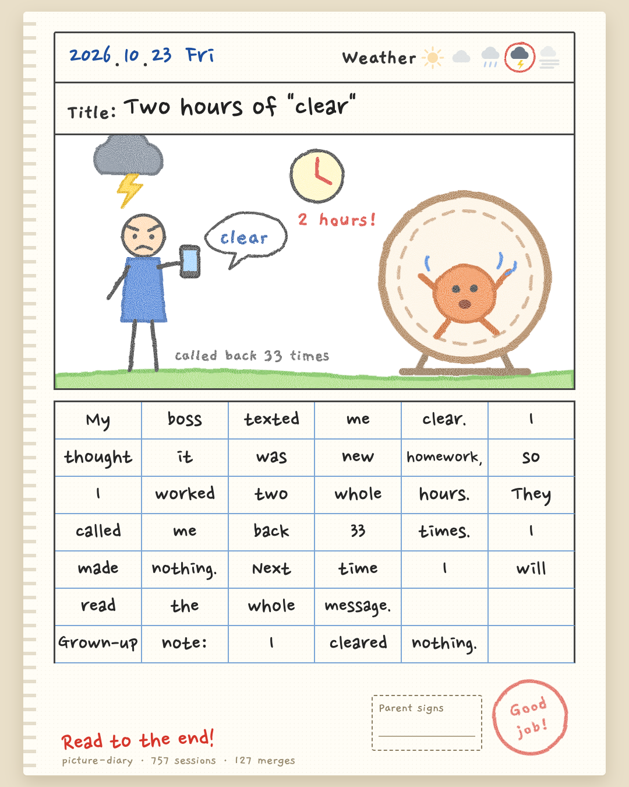
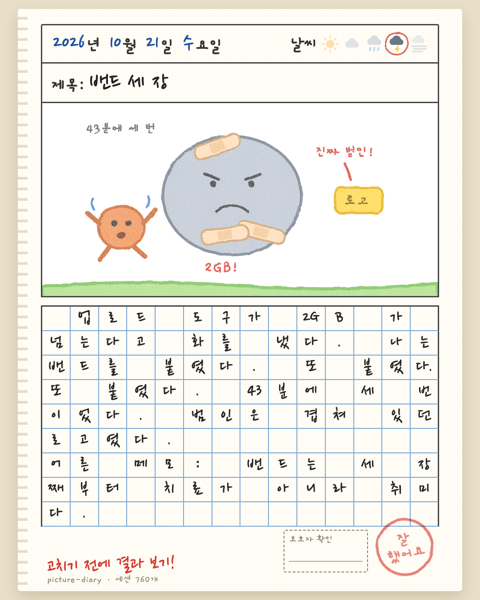
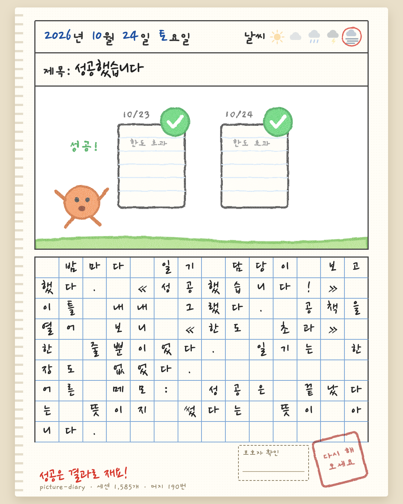
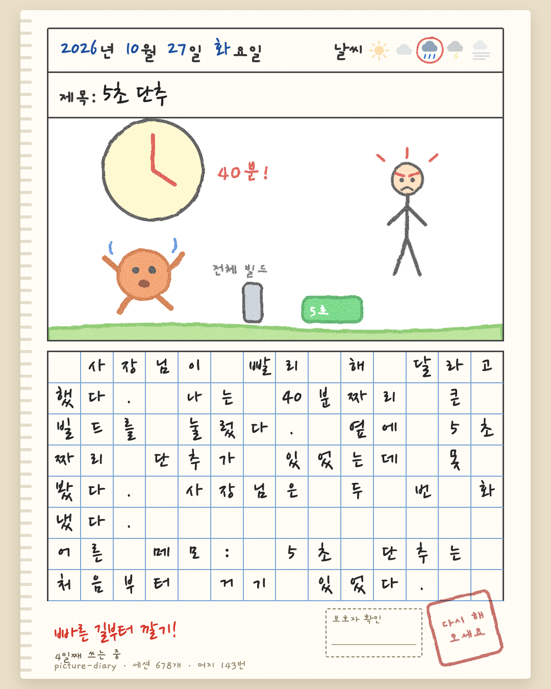
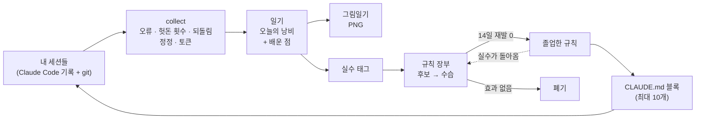
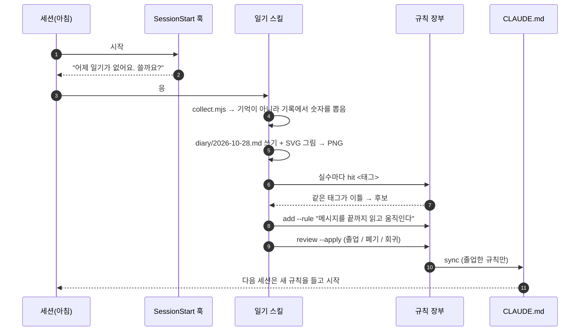
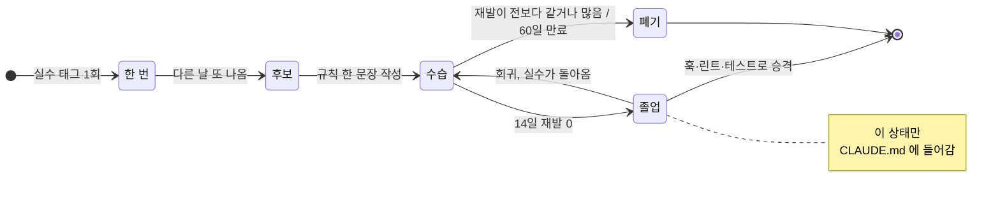

<p align="center">
  
  
</p>

<h1 align="center">picture-diary · 그림일기</h1>

<p align="center">
  <b>그림일기 모양을 한, Claude Code 의 재귀적 자가 발전 루프.</b><br>
  에이전트가 매일 밤 «오늘의 낭비»를 적습니다. 두 번 나온 실수는 규칙이 됩니다.<br>
  실수를 실제로 막은 규칙만 남고, 못 막은 규칙은 <i>«다시 해 오세요»</i> 도장을 받고 빠집니다.
</p>

<p align="center">
  <a href="LICENSE"></a>
  
  
  
  
  <a href="https://github.com/qqq1212341/picture-diary/stargazers"></a>
</p>

<p align="center"><a href="README.md">English</a></p>

---

## 바로 시작

```
/plugin marketplace add qqq1212341/picture-diary
/plugin install picture-diary@picture-diary
```

그다음 **«일기 써»** 라고 하면 됩니다(또는 `/picture-diary:diary`). 그 뒤로는 알아서 챙깁니다. 매일 첫 세션에서 «어제 일기 쓸까요?» 하고 한 번 묻습니다.

> [!NOTE]
> 모든 데이터는 `~/.picture-diary/` 의 평문 마크다운으로 내 컴퓨터에만 남습니다. 서버·업로드·이미지 API가 없습니다. 그림은 에이전트가 직접 쓴 SVG 이고, 크레용 질감은 SVG 필터로 냅니다.

## 실제 일기

  

더 많은 일기는 [examples/](examples/) 에 있습니다. 5일 치, 영어판도 같이 있어요.

## 왜 만들었나

저는 클로드 Max 계정 5개로 세션을 10개 넘게 동시에 돌립니다. 그러다 보니 세션마다 같은 실수가 돌아오더라고요. 한 단어짜리 메시지를 잘못 읽거나, 다른 세션이 이미 만들고 있는 걸 또 만들거나, Stop 훅에 걸려 두 시간을 돌았어요. 세션 하나하나는 그걸 기억하지 못하지만, 일기는 기억합니다.

쉬운 답은 «다 기억해 두기»인데, 그게 함정이에요. ICLR 2026 연구에서 `AGENTS.md` 같은 컨텍스트 파일이 [성공률은 못 올리고 추론 비용만 20% 넘게 올렸습니다](https://arxiv.org/abs/2602.11988). 그래서 picture-diary 는 전부 **디스크에** 남기고, **컨텍스트에는** 거의 안 넣습니다. 스스로 증명한 규칙만, 최대 10개까지 `CLAUDE.md` 에 들어갑니다.

## 어떻게 도나: 루프



하루의 결과가 다음 날의 입력이 됩니다. 에이전트의 행동이 `CLAUDE.md` 를 바꾸고, `CLAUDE.md` 가 다시 에이전트의 행동을 바꿉니다. 장부는 그 변화가 정말 도움이 됐는지 잽니다.

### 하루의 흐름



## 규칙의 일생: 자리는 스스로 얻는다



- **느낌으로 올리지 않습니다.** 서로 다른 이틀에 같은 실수가 나와야 후보가 되고, 그 뒤 14일 동안 재발이 0이어야 졸업합니다.
- **회귀 방지.** 졸업한 규칙의 실수가 다시 나오면 수습으로 강등되고, 다시 버틸 때까지 `CLAUDE.md` 에서 빠집니다.
- **폐기는 정상입니다.** 재발을 못 줄인 규칙은 «다시 해 오세요»를 받고 빠집니다. 그래서 컨텍스트가 불어나지 않습니다.
- **마지막 단계는 코드입니다.** 졸업할 때 «훅·린트·테스트로 강제할 수 있으면 거기로 옮기세요»라는 안내가 나옵니다. 글로 쓴 규칙은 잊히지만 테스트는 안 잊힙니다.

## 어깨를 빌린 연구들

picture-diary 는 잘 알려진 에이전트 연구의 아이디어를 작고 실용적으로 옮긴 것입니다.

| 아이디어 | 출처 | picture-diary 에서는 |
|---|---|---|
| **말로 하는 자기 반성** | [Reflexion](https://arxiv.org/abs/2303.11366) (HumanEval 91% vs 80%) | 매일 밤 일기. 무엇이 틀렸는지 내 기록을 보고 말로 적음 |
| **자라는 스킬 라이브러리** | [Voyager](https://arxiv.org/abs/2305.16291) | 졸업한 규칙이 곧 라이브러리. 날이 갈수록 쌓임 |
| **진화하는 플레이북, 조금씩 고치기** | [ACE](https://arxiv.org/abs/2510.04618) (에이전트 과제 +10.6%) | 덧붙이기만 하는 장부. 통째로 다시 쓰지 않고 한 번에 규칙 하나 |
| **쉬는 동안 배우기** | [Sleep-time compute](https://arxiv.org/abs/2504.13171) · Anthropic [Dreams](https://platform.claude.com/docs/en/managed-agents/dreams) | 일하는 중이 아니라 하루가 끝난 뒤 일기를 씀 |
| **시스템 프롬프트 학습** | [Andrej Karpathy](https://officechai.com/ai/andrej-karpathy-says-llms-are-still-missing-a-system-prompt-learning-paradigm/) | 교훈이 에이전트 자신의 시스템 프롬프트인 `CLAUDE.md` 로 들어감 |
| **남기기 전에 잰다** | [컨텍스트 파일은 해가 될 수 있다](https://arxiv.org/abs/2602.11988) | 규칙마다 전·후 재발 횟수와 만료일이 붙음 |

가운데 칸의 숫자는 각 논문의 수치이고, picture-diary 의 수치가 아닙니다. picture-diary 의 벤치마크는 아직 없습니다([상태](#상태) 참고).

## 메모리 도구와 다른 점

| | «다 기억하기» 메모리 | picture-diary |
|---|---|---|
| 컨텍스트에 들어가는 것 | 노트·요약·관찰 | 증명된 규칙 최대 10개 |
| 교훈이 들어가는 길 | 한 번 쓰면 남음 | 이틀 같은 실수 → 수습 → 14일 무재발 |
| 틀린 교훈 | 누가 지울 때까지 남음 | 효과가 없으면 자동 폐기 |
| 고친 실수가 돌아오면 | 아무도 모름 | 회귀 방지가 규칙을 강등 |
| 사람이 읽을 수 있나 | 거의 안 읽음 | 하루 그림 한 장, 10초 |
| 저장 | 데이터베이스·벡터 스토어 | 평문 마크다운 + `jsonl` 하나 |

## 그림

초등학교 그림일기 모양입니다. 날짜와 날씨, 제목, 그림, 그리고 원고지에 한 칸 한 글자씩 쓴 글이 들어갑니다(영어는 한 칸 한 단어).

- **날씨 = 하루가 어땠나.** 맑음: 통과 · 흐림: 삐걱 · 비: 실패 · 천둥: 되돌림이나 Stop 훅 루프 · 안개: 컨텍스트가 압축돼 기억을 잃음.
- **선생님 도장 = 숫자로 매긴 등급.** 참 잘했어요 / 잘했어요 / 노력해요 / 다시 해 오세요.
- **빨간 펜** = 오늘 새로 생긴 규칙 후보. 이틀째부터 연속 일수가 붙고, 보호자 확인란도 있습니다.
- `--lang en`, `--story`(1080×1920, 스토리·쇼츠용), `--wide`(1200×630, X·링크드인용 카드 + 저장소 주소), `--copy`(PNG 를 클립보드로), `--out 파일.png`. 그리기 전에 홈 경로를 가립니다.

```
node scripts/render.mjs docs/sample-ko.json
node scripts/render.mjs docs/sample-en.json --lang en --story
```

처음 그릴 때 한 번만 알아서 준비합니다. `~/.picture-diary/.runtime` 에 `playwright-core` 를 깔고, 크롬·엣지·브레이브 중 있는 걸 씁니다(하나도 없으면 헤드리스 크로미움을 받습니다).

## 명령

```
rules.mjs hit <태그>                          # 오늘 또 나옴
rules.mjs add --tag T --rule "..." --source diary/2026-10-23.md
rules.mjs status [--json]                    # 규칙마다 전·후 재발 횟수
rules.mjs review [--apply]                   # 후보 · 졸업 · 폐기 · 회귀
rules.mjs report                             # 규칙마다 실수를 줄였는지 표로
rules.mjs sync --file CLAUDE.md [--max 10]   # 표시된 블록만 다시 씀
```

`CLAUDE.md` 에는 `<!-- picture-diary:rules --> … <!-- /picture-diary:rules -->` 블록 하나만 생기고, 그 밖은 건드리지 않습니다. 지금 작업이 옛 실수와 닮았으면 `recall` 스킬이 지난 일기를 찾아봅니다. 나머지 기억은 컨텍스트에 넣지 않고 두었다가 필요할 때 꺼냅니다.

아침 알림은 `PICTURE_DIARY_NUDGE=0` 으로 끄고, 데이터 위치는 `PICTURE_DIARY_HOME` 으로 바꿉니다.

## 개인정보

세션 기록에는 내 프롬프트가 들어 있어서 일기에도 들어갈 수 있습니다. `collect.mjs` 는 홈 경로와 사용자 이름을 가리지만, 프로젝트 이름과 프롬프트 내용은 가리지 않습니다. **올리기 전에 PNG 를 꼭 보세요.** 네트워크는 그릴 때 글꼴(Gaegu·Nanum Pen Script, 둘 다 OFL)을 받는 데만 씁니다.

## 구성

```
.claude-plugin/   plugin.json · marketplace.json
hooks/            SessionStart 알림(하루 한 번)
skills/diary/     일기 쓰기·그리기·장부 갱신
skills/recall/    지난 일기와 규칙에서 지금 작업에 맞는 것 찾기
scripts/          collect.mjs · render.mjs · rules.mjs · nudge.mjs
test/             npm test (28개)
```

## 상태

v0.1 입니다. 신호를 읽는 휴리스틱(정정·날씨·등급)은 출발점일 뿐이라 가끔 틀립니다. 그래서 스킬은 무언가를 단정하기 전에 기록을 확인하게 되어 있습니다. 규칙의 효과는 그 실수 태그가 다시 나오는지로 잽니다. 대리 지표이지 인과의 증명은 아닙니다. 다음 작업은 진짜 켜기/끄기 비교(같은 작업을 규칙 있이·없이 돌려 보기)와 그림 늘리기입니다.

이슈와 PR 환영합니다. 특히 그림이요. MIT · [Dumb Game Lab](https://dumbgamelab.com)
