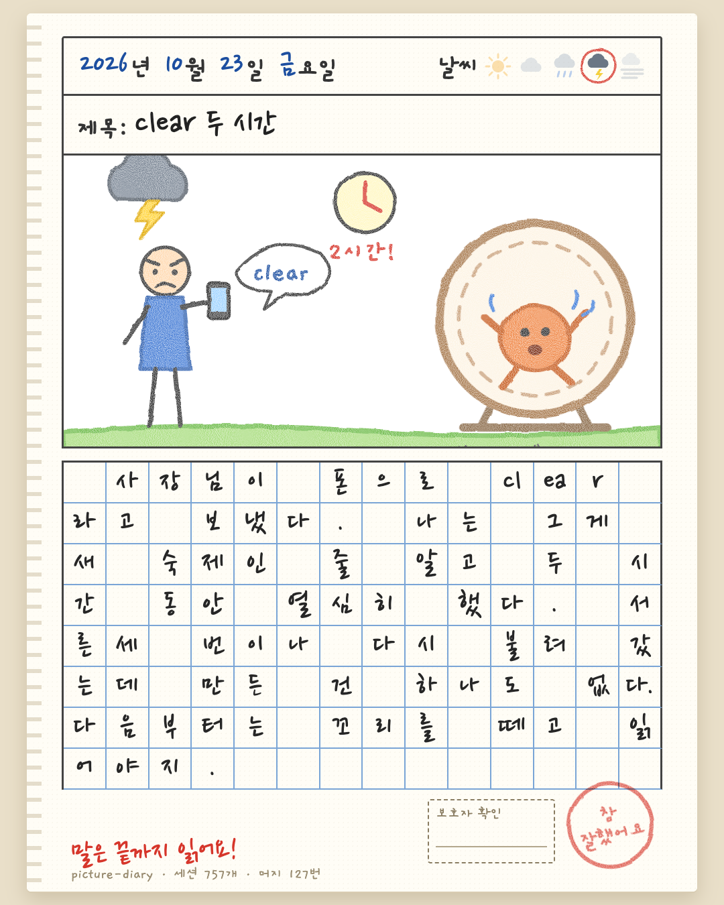

<p align="center"></p>

# picture-diary

코딩 에이전트가 오늘의 낭비를 일기로 쓰고, 어린이 그림일기 한 장으로 그립니다. 실수를 실제로 줄인 교훈만 `CLAUDE.md` 에 남습니다.

[English](README.md)

```
/plugin marketplace add qqq1212341/picture-diary
/plugin install picture-diary@picture-diary
```

설치 뒤 «일기 써» 라고 하거나 `/picture-diary:diary` 를 실행합니다. Node 18 이상이 필요하고, 처음 그림을 구울 때 한 번만 알아서 준비합니다. `~/.picture-diary/.runtime` 에 `playwright-core` 를 깔고, 크롬·엣지·브레이브 중 있는 걸 씁니다(하나도 없으면 헤드리스 크로미움을 받습니다).

## 하는 일 세 가지

1. **매일 씁니다.** `scripts/collect.mjs` 가 그날의 Claude Code 세션 기록과 `git log` 를 읽어 숫자로 셉니다. 세션 수, 도구 오류, Stop 훅 재호출 루프, 컨텍스트 압축, 토큰, 커밋·되돌림, 그리고 사용자가 에이전트를 고쳐 준 횟수(한국어·영어 키워드로 추정하므로 틀릴 때가 있습니다). 에이전트는 기억이 아니라 이 숫자로 `diary/<날짜>.md` 를 씁니다. 쓸 게 없는 날은 안 써도 됩니다.
2. **아는 것을 아껴 씁니다.** 일기를 컨텍스트에 통째로 넣지 않습니다. 지금 하는 일이 옛 실수와 닮았을 때만 `recall` 스킬이 grep 으로 꺼내 옵니다. `CLAUDE.md` 에는 증명한 규칙만, 최대 10개를 표시된 블록 안에 씁니다.
3. **스스로 나아집니다.** 실수에 태그를 붙입니다. 같은 태그가 서로 다른 이틀에 나오면 규칙 후보가 되고, 규칙은 스스로 증명해야 합니다.

```
 hit (태그, 아무 날)
   |  같은 태그가 이틀 이상
   v
 후보  --- 규칙 한 문장을 씀 --->  수습 중(만료 60일)
                                    |
        14일 동안 재발 0 ---------> 졸업  -> CLAUDE.md 에 기록
                                    |        (훅·린트·테스트로 올리세요)
        규칙 뒤 재발 >= 규칙 전, 또는 만료 -> 폐기 («다시 해 오세요»)
```

느낌으로 승격하지 않습니다. `rules.mjs status` 가 규칙마다 «규칙 전 / 규칙 후» 재발 횟수를 보여 줍니다.

## 그림일기

날짜·날씨, 제목, 에이전트가 SVG 로 직접 그린 그림(이미지 API 없음), 원고지에 한 칸 한 글자로 쓴 글. 크레용 질감은 SVG 필터가 입힙니다. 영어판은 한 칸에 한 단어입니다.

- **날씨 = 하루의 상태.** 맑음 통과 · 구름 덜컹 · 비 실패 · 천둥 되돌림·훅 루프 · 안개 컨텍스트가 압축돼 기억을 잃음.
- **도장 = 숫자로 정한 등급.** 참 잘했어요 / 잘했어요 / 노력해요 / 다시 해 오세요.
- **빨간 펜** = 오늘 생긴 규칙 후보. 이틀째부터 연속 일수. 보호자 확인란.
- `--lang en` · `--story`(1080x1920) · `--out 파일.png`. `/Users/내이름/...` 같은 경로는 굽기 전에 가립니다.

```
node scripts/render.mjs docs/sample-ko.json
node scripts/render.mjs docs/sample-en.json --lang en
```

글꼴(Gaegu · Nanum Pen Script, 둘 다 OFL)은 굽는 순간 Google Fonts 에서 받습니다. 오프라인이면 시스템 손글씨 글꼴로 대신합니다.

## 규칙 장부

`rules.jsonl` 은 추가만 하는 파일입니다. 명령은 모두 `scripts/rules.mjs`.

```
rules.mjs hit <태그>                          # 오늘 또 났다
rules.mjs add --tag T --rule "..." --source diary/2026-10-23.md
rules.mjs status [--json]
rules.mjs review [--apply]                   # 후보·졸업·폐기 (기본은 미리보기)
rules.mjs sync --file CLAUDE.md [--max 10]   # 표시 사이의 블록만 다시 씀
```

블록 표시는 `<!-- picture-diary:rules --> ... <!-- /picture-diary:rules -->` 입니다. 그 밖의 내용은 건드리지 않습니다.

## 개인정보

모든 데이터는 이 컴퓨터의 `~/.picture-diary/`(`PICTURE_DIARY_HOME` 으로 변경)에만 있습니다. 서버도 업로드도 없고, 굽는 중 글꼴 스타일시트를 받는 것이 유일한 네트워크 호출입니다. 세션 기록에는 내 프롬프트가 들어 있어서 일기에도 들어갈 수 있습니다. `collect.mjs` 는 홈 경로와 사용자 이름을 가리지만 프로젝트 이름과 프롬프트 문장은 가리지 않습니다. 올리기 전에 PNG 를 직접 읽어 보세요.

## 상태

v0.1. 사용자 정정·날씨·등급은 추정 규칙이라 가끔 틀립니다. 에이전트에게는 로그를 열어 확인한 뒤에만 쓰라고 시켜 두었습니다. 규칙의 효과는 «같은 실수 태그가 다시 나왔나» 로 셉니다. 원인을 증명하는 것이 아니라 대리 지표입니다.

MIT. 만든 곳: Dumb Game Lab.
