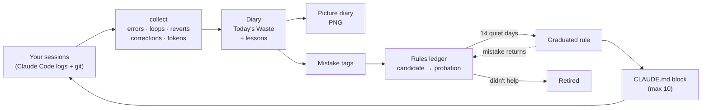
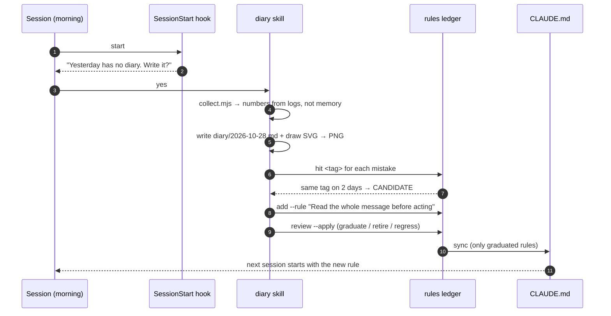
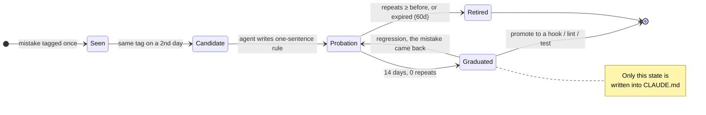

<p align="center">
  
  
</p>

<h1 align="center">picture-diary</h1>

<p align="center">
  <b>A recursive self-improvement loop for Claude Code, disguised as a kid's picture diary.</b><br>
  Every night your agent writes down what it wasted. The mistakes that repeat become rules.<br>
  Rules that stop the mistake stay. Rules that don't get <i>"See me after class."</i>
</p>

<p align="center">
  <a href="LICENSE"></a>
  
  
  
  
  <a href="https://github.com/qqq1212341/picture-diary/stargazers"></a>
</p>

<p align="center"><a href="README.ko.md">한국어</a></p>

---

## Quick start

```
/plugin marketplace add qqq1212341/picture-diary
/plugin install picture-diary@picture-diary
```

Then say **"write the diary"** (or `/picture-diary:diary`). After that it reminds itself: the first session of each day asks once whether to write yesterday's page.

> [!NOTE]
> Everything is local plain markdown in `~/.picture-diary/`. No server, no upload, no image API. The drawing is SVG the agent writes itself, and the crayon look comes from an SVG filter.

## Why

I run five Claude Max accounts and more than ten sessions at once. The same mistakes kept coming back in different sessions: misreading a one-word message, rebuilding something another session was already building, looping on a Stop hook for two hours. No single session remembers. The diary does.

The obvious fix is "remember everything." That is also the trap. An ICLR 2026 study found that context files like `AGENTS.md` [did not raise success rates and raised inference cost by over 20%](https://arxiv.org/abs/2602.11988). So picture-diary remembers everything **on disk** and puts almost nothing **in context**. Only rules that proved themselves, at most 10, go into `CLAUDE.md`.

## How it works: the loop



The output of one day is the input of the next. That is the whole idea: the agent's behavior changes `CLAUDE.md`, `CLAUDE.md` changes the agent's behavior, and the ledger measures whether each change actually helped.

### One day, step by step



## Rule lifecycle: rules must earn their place



- **Nothing is promoted on a feeling.** A rule needs the same mistake on two different days, then has to show zero repeats for 14 days.
- **Regression guard.** If a graduated rule's mistake shows up again, the rule is demoted to probation and leaves `CLAUDE.md` until it holds again.
- **Retirement is normal.** A rule that did not reduce repeats gets *"See me after class"* and is dropped, so the context never bloats.
- **Last step is code.** Graduation prints a hint: if a hook, a linter or a test can enforce this, move it there. Written rules get forgotten. Tests don't.

## Standing on the shoulders of

picture-diary is a small, practical take on ideas from well-known agent research:

| Idea | Where it comes from | What picture-diary does with it |
|---|---|---|
| **Verbal self-reflection** | [Reflexion](https://arxiv.org/abs/2303.11366) (HumanEval 91% vs 80%) | The nightly diary: what went wrong, in words, from the agent's own logs |
| **Skill library that grows** | [Voyager](https://arxiv.org/abs/2305.16291) | Graduated rules are the library; they compound across days |
| **Evolving playbook, delta updates** | [ACE](https://arxiv.org/abs/2510.04618) (+10.6% on agent tasks) | Append-only ledger; one small rule at a time, never a rewrite |
| **Learning offline, while idle** | [Sleep-time compute](https://arxiv.org/abs/2504.13171), Anthropic's [Dreams](https://platform.claude.com/docs/en/managed-agents/dreams) | The diary is written after the day, not during the work |
| **System prompt learning** | [Andrej Karpathy](https://officechai.com/ai/andrej-karpathy-says-llms-are-still-missing-a-system-prompt-learning-paradigm/) | Lessons land in `CLAUDE.md`, the agent's own system prompt |
| **Measure before you keep it** | [Context files can hurt](https://arxiv.org/abs/2602.11988) | Every rule has a before/after repeat count and an expiry date |

The numbers in the middle column are from those papers, not from picture-diary. picture-diary has no benchmark yet (see [Status](#status)).

## Memory vs. picture-diary

| | "Remember everything" memory | picture-diary |
|---|---|---|
| What goes into context | Notes, summaries, observations | At most 10 rules that proved themselves |
| How a lesson gets in | Written once, kept | Same mistake on 2 days → probation → 14 quiet days |
| Bad lessons | Stay until someone deletes them | Retired automatically when they don't help |
| A fixed mistake comes back | Nobody notices | Regression guard demotes the rule |
| Can a human read it? | Rarely | One picture a day, 10 seconds |
| Storage | Database / vector store | Plain markdown + one `jsonl` in your home folder |

## The picture

A Korean elementary-school picture diary (그림일기): date and weather, a title, a drawing, and the text on manuscript paper, one character per cell (English: one word per cell).

- **Weather = how the day went.** sun: passed · cloud: bumpy · rain: failures · storm: reverts or Stop-hook loops · fog: context was compacted and the agent forgot things.
- **Teacher's stamp = grade from the numbers.** Good job! / Nice work / Try harder / See me after class.
- **Red pen** = today's new rule candidate. A streak counter from day 2. A box for a parent's signature.
- `--lang en`, `--story` (1080×1920 for Stories/Shorts), `--wide` (1200×630 card for X / LinkedIn, with your repo link), `--copy` (PNG to clipboard), `--out file.png`. Home paths are masked before rendering.

```
node scripts/render.mjs docs/sample-en.json --lang en
node scripts/render.mjs docs/sample-ko.json --story
```

The first render sets itself up once: it installs `playwright-core` into `~/.picture-diary/.runtime` and uses your Chrome, Edge or Brave (or downloads a headless Chromium if you have none).

## Commands

```
rules.mjs hit <tag>                          # it happened again today
rules.mjs add --tag T --rule "..." --source diary/2026-10-23.md
rules.mjs status [--json]                    # every rule with before / after repeat counts
rules.mjs review [--apply]                   # candidates · graduations · retirements · regressions
rules.mjs report                             # markdown table: did each rule reduce its mistake?
rules.mjs sync --file CLAUDE.md [--max 10]   # rewrites only the marked block
```

`CLAUDE.md` gets one block, `<!-- picture-diary:rules --> … <!-- /picture-diary:rules -->`. Everything outside it is left alone. The `recall` skill greps old diaries when a task looks like an old mistake, so the rest of the memory is there when you need it without being in context.

Silence the morning reminder with `PICTURE_DIARY_NUDGE=0`. Move the data with `PICTURE_DIARY_HOME`.

## Privacy

Session logs contain your prompts, so the diary can too. `collect.mjs` masks home paths and user names; project names and prompt text are not masked. **Look at the PNG before you post it.** The only network call is the font stylesheet (Gaegu and Nanum Pen Script, both OFL) when rendering.

## Layout

```
.claude-plugin/   plugin.json · marketplace.json
hooks/            SessionStart reminder (once a day)
skills/diary/     write the diary, draw it, update the ledger
skills/recall/    search past diaries and rules for the current task
scripts/          collect.mjs · render.mjs · rules.mjs · nudge.mjs
test/             npm test (28 tests)
```

## Status

v0.1. The signal heuristics (corrections, weather, grade) are starting points and will sometimes be wrong; the skill tells the agent to check the logs before claiming anything. A rule's effect is measured by whether its mistake tag recurs. That is a proxy, not proof of cause. Next up: a true on/off ablation (run the same task with and without a rule), and more drawings.

Issues and PRs welcome, especially drawings. MIT · made by [Dumb Game Lab](https://dumbgamelab.com).
