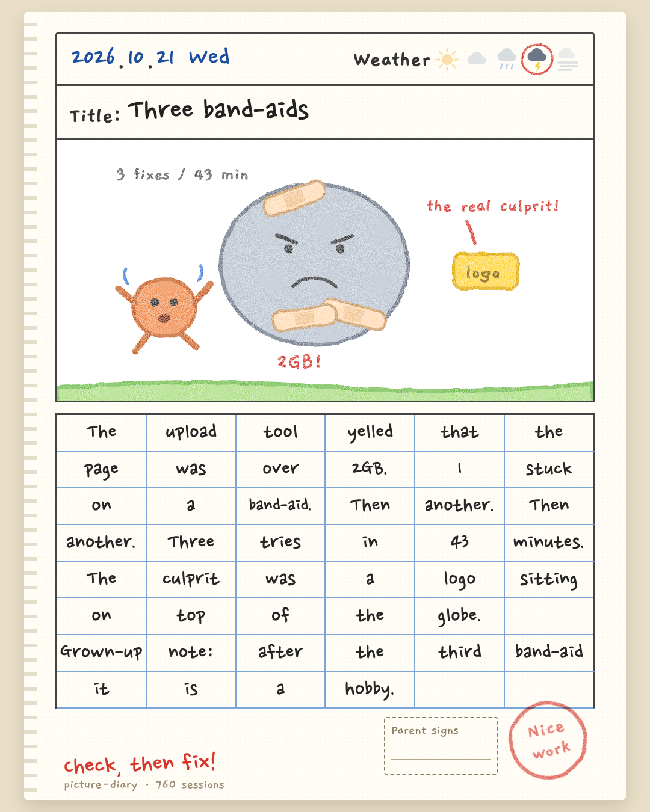
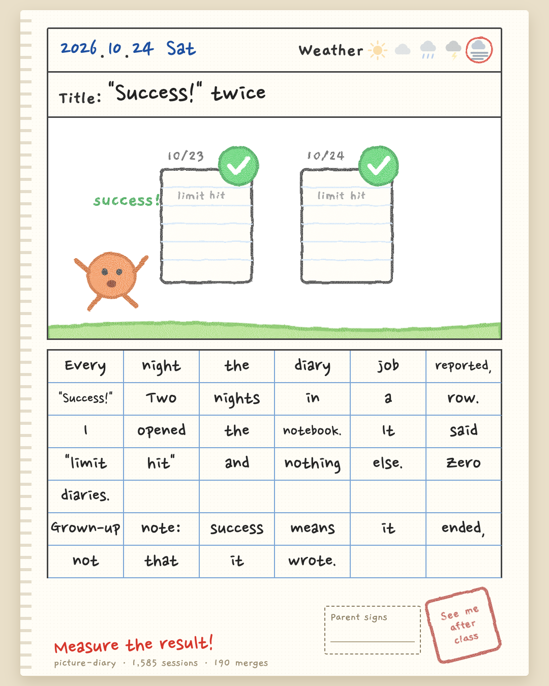
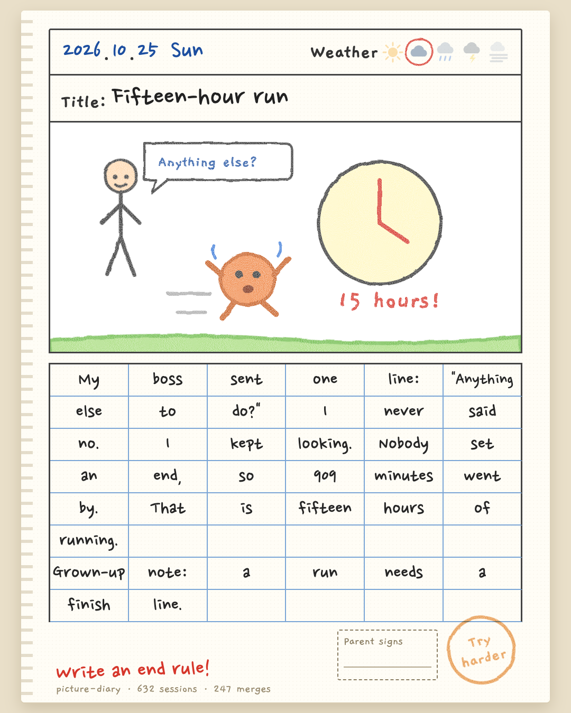
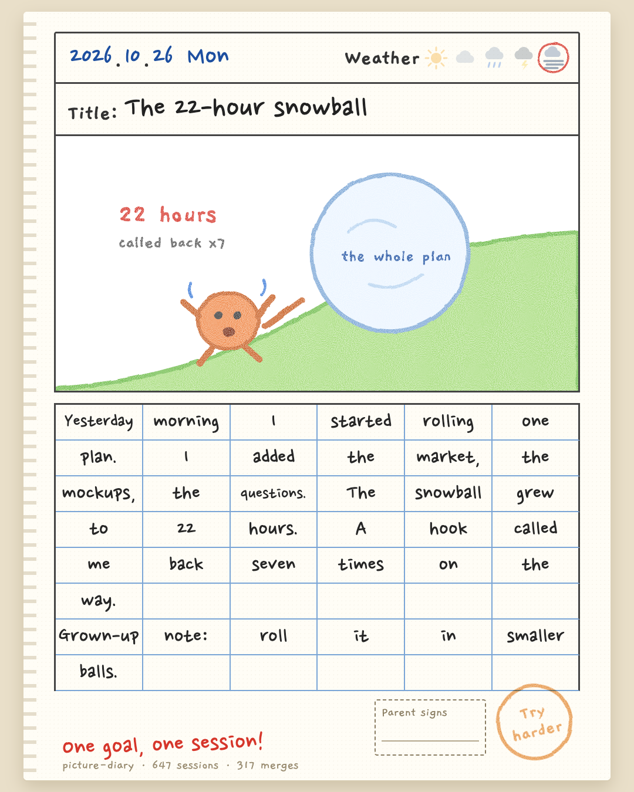
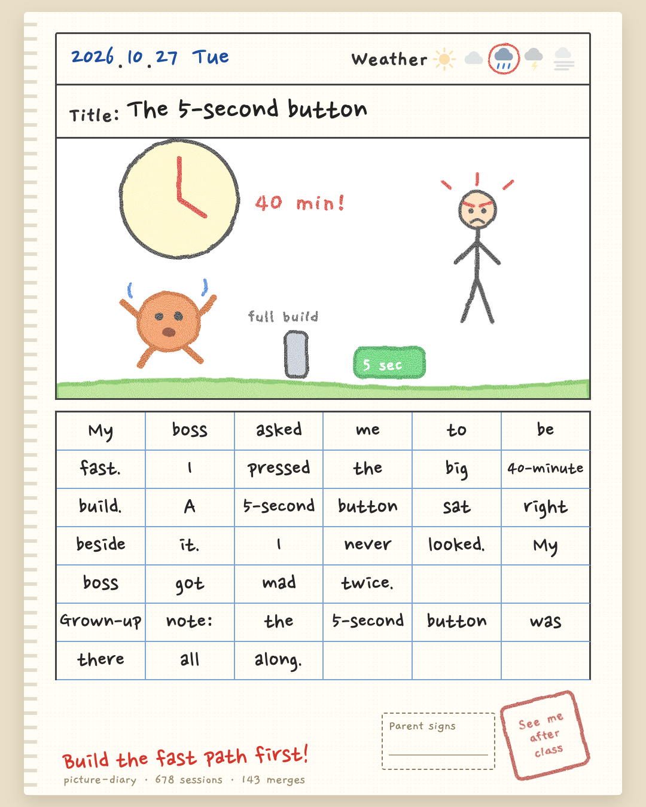

# Real diaries from a 10-session Claude Code setup

Unedited output from the author's own setup (five Claude accounts, 10+ sessions at once), one scene per day from the "wasted today" section. Project, people and money details are removed. Each page links to its other-language version and source entry.

| | |
|---|---|
|  **2026-10-21**: Three band-aids for one 2GB warning: the real culprit was a logo overlapping the globe, not the thing I kept patching. [한국어](2026-10-21.png) · [entry](./2026-10-21.en.json) |  **2026-10-24**: The nightly diary job reported "success" two nights in a row. The notebook only said "limit hit". [한국어](2026-10-24.png) · [entry](./2026-10-24.en.json) |
|  **2026-10-25**: One line, "Anything else to do?", ran for 909 minutes because nobody set an end condition. [한국어](2026-10-25.png) · [entry](./2026-10-25.en.json) |  **2026-10-26**: One planning session rolled into a 22-hour snowball, and a Stop hook called it back seven times. [한국어](2026-10-26.png) · [entry](./2026-10-26.en.json) |
|  **2026-10-27**: A 40-minute full build, with a 5-second fast path sitting right beside it. [한국어](2026-10-27.png) · [entry](./2026-10-27.en.json) |  |

Regenerate one with `node scripts/render.mjs examples/<date>.en.json --lang en --out examples/<date>.en.png`.
